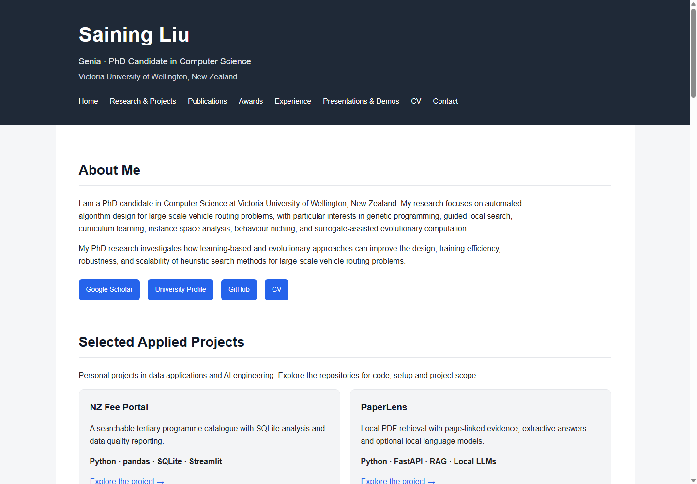

# Saining Liu — Research and Project Portfolio

Give recruiters and research collaborators a clear route from a project claim to its supporting work.

## Purpose

Research descriptions, code repositories and project demonstrations are separate entry points. The previous homepage primarily described research, leaving applied projects harder to discover from that page.

The objective of the revised portfolio is to **help a reader identify relevant work, understand its purpose and follow a direct link to code, a demonstration or research evidence**.

## Approach

The HTML/CSS site keeps stable pages for research, publications and professional background. The homepage adds selected applied-project summaries and repository links, so a brief introduction leads to the project's own technical evidence. Existing topic URLs are retained.

## Result and remaining evaluation

The local revision adds entry points for **NZ Fee Portal, PaperLens and WAINET**, alongside the research content. The site was rendered locally, and its local page/asset links were checked. The revised site has not yet been published.



The completed output is a navigable portfolio revision. Improvements in discoverability, recruiter engagement or interview outcomes have not been measured; a future review could ask readers to locate a project's objective, implementation and evidence.

[Current public portfolio](https://itissn.github.io/)

**Implementation:** HTML · CSS · GitHub Pages · Technical communication

## Edit and preview

```bash
python -m http.server 8080 --bind 127.0.0.1
```

Open `http://127.0.0.1:8080`. No frontend build or package installation is required.

| Location | Responsibility |
|---|---|
| `index.html` | Introduction and selected project entry points |
| `research.html`, `research-projects.html` | Research explanations |
| `publications.html` | Publication record |
| Other root HTML pages | Stable topic-specific page URLs |
| `style.css` | Shared presentation |
| `assets/` | Referenced images and documents |

Keep root page names stable so existing links continue to work. Before publishing, inspect the pages at desktop and mobile widths and check that project status, publication status and dates are current. Each project repository remains the source for its technical claims.
